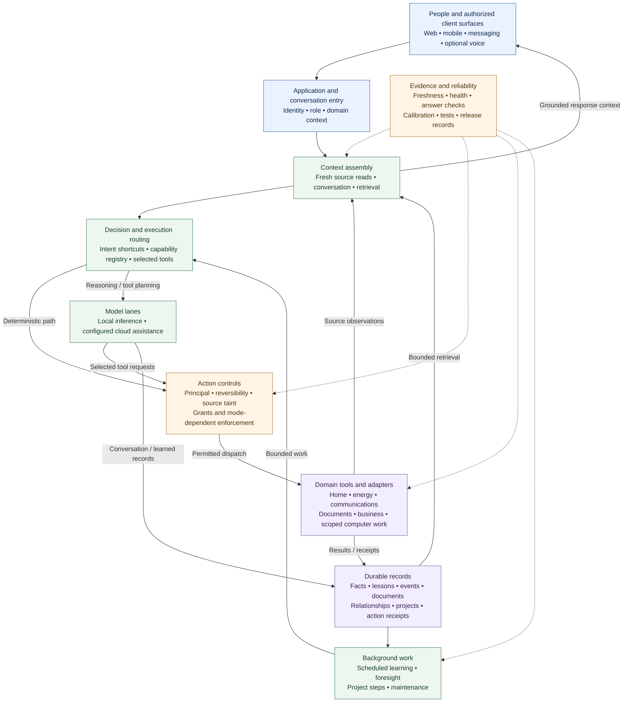

# ARIA — Current Architecture

**An integrated assistant platform connecting conversation, persistent memory, environmental observations, and bounded action across home and work.**

Snapshot: **October 14, 2026**. Source baseline: `aria-platform@1cd946055bee6469429605b6f71c9c5fe37a7ab2`.

This overview describes implemented architecture at that source revision. It is a public synthesis of private implementation and dated engineering evidence. It does not certify the revision currently loaded on a production host. Features described as implemented still depend on configuration, permissions, dependencies, hardware, and source health.

## Architecture at a glance

ARIA combines a modular application runtime with durable memory, multiple model lanes, a shared capability catalog, domain tools, and continuing background work. Deterministic handlers and structured readers carry routine work; language models handle selected reasoning and tool planning. Observations, conversations, project progress, and execution receipts can persist across sessions.

The architectural strength is the breadth of these connected mechanisms: the same platform can retrieve remembered context, consult current equipment state, work with business records, generate a document, and continue a saved project. Each route has its own operating prerequisites and evidence limits.

*Logical view of implemented responsibilities and data paths. Dashed lines represent checking mechanisms. The diagram does not imply that every check covers every route or that every optional integration is enabled.*

[Download the Mermaid source](ARIA_Current_Architecture.mmd).

## 1. A modular runtime with distributed support

The application uses Python, Flask, Waitress, SQLAlchemy, and SQLite-backed stores. A declarative subsystem registry manages attachment order, dependencies, startup status, and reverse-order shutdown. Optional subsystem failures can be reported separately from the main application's availability.

Industry packs provide domain-specific models, routes, and tool configuration. Identity and domain-access records control application access; domain-owned data can live in separate database binds. Packs can remain in the source while their routes and skills are intentionally parked.

Deployment documentation describes an application brain supported by separate model, perception, and interactive-computer services. The node-pool resolver selects configured local inference resources by role and availability. This allows interactive reasoning and latency-tolerant background work to use different compute resources.

**Practical significance:** ARIA has explicit lifecycle management and separable workloads. A module's presence, successful startup, and useful live behavior remain distinct measurements.

## 2. Conversation connected to tools and the world

Conversation entry points assemble identity, domain context, recent conversation, retrieved memory, and current-source context. An intent and capability layer routes recognized requests to deterministic handlers. Selected turns proceed through local or cloud model paths.

The local tool loop supports native model tool calls and a structured prompt protocol for models whose serving template does not expose native tools. Tool selection is a view over existing registries, filtered by policy and reversibility limits. Cloud-assisted paths can use MCP-backed tools. The general model client also contains configured provider and fallback routing; routing differs by caller, task, configuration, and availability.

A central capability registry describes **more than 200 capability entries** in the pinned source. Entries connect user phrasing, intent classes, handlers, data sources, and related tools or surfaces. This is metadata breadth, not a count of independently verified live abilities; capabilities, skills, and model tools are overlapping catalogs.

Current-context machinery distinguishes:

| Information class | Meaning |
|---|---|
| Observed now | A recent source read, with its freshness and coverage limits |
| Recorded | An event or artifact valid at its recorded time |
| Remembered | A stored fact, lesson, or pin that may age |
| Inferred | A pattern, prediction, or generated conclusion |

The reality snapshot names source freshness and blind spots. Answer and grounding mechanisms can withhold unsupported or empty answers. A vendor's state report remains a report; it does not automatically establish an independently observed physical result.

**Practical significance:** ARIA can combine remembered context with a fresh read before answering or acting. Context budgets and source health determine what a particular turn actually receives.

## 3. Memory that persists, retrieves, and connects

The memory architecture includes conversation records, facts, lessons, embeddings, curated pins, archives, and hot/warm/cold retrieval machinery. The tiered memory router selects time-relevant shards, opens bounded parallel read-only connections, and merges results. Archive routing can create additional cold shards.

The relationship graph harvests structured relationships from sources such as pattern records, experiments, identity observations, automations, and action-trust records. Neighbor and path queries connect related entities and supply bounded prompt context. Fact reconciliation, lineage, living-truth, and truth-sweep mechanisms provide separate ways to examine updates, supersession, and contradiction.

Durable projects add goals, steps, scratchpads, decisions, artifacts, and append-only events. The project runner dispatches bounded steps through the job machinery, preserves restart continuity, and uses step bindings and claim/receipt checks. Its documented execution contract distinguishes a model's completion claim from evidence of effect.

**Practical significance:** ARIA has machinery for continuity across conversations and restarts. Retrieval and relationships support useful connections; their existence does not demonstrate a complete understanding of every stored fact.

## 4. Implemented capability domains

| Domain | Implemented mechanisms | Operating boundary |
|---|---|---|
| Home and equipment | Direct-vendor state aggregation, room mapping, lights, scenes, climate, media, and specialized device adapters | Connected devices, supported commands, fresh reads, and granted authority |
| Energy and property | Electrical ingest, circuit history, threshold/baseline analysis, mapping, load-signature work, and troubleshooting | Instrumentation, circuit mapping, measurement quality, and enabled sensing |
| Perception | Camera records, observations, timeline readers, face/voice-related records, sound and scene paths | Producer/model availability, coverage, identity evidence, and freshness |
| Routines and foresight | Pattern candidates, association experiments, prediction/notice detectors, cooldowns, expiry, and arrival workflows | Finite samples and configured detectors; association does not prove causation |
| Communications | Email and calendar tools, messaging adapters, push, speech generation, and optional room-voice routing | Account scopes, write policy, channel availability, and delivery evidence |
| Documents and research | Document library, generation, lifecycle/versioning, export paths, data skills, web search/fetch, and browser work | Renderer dependencies, bounded access, source quality, and sensitive-content controls |
| Business and finance | Customers/jobs, pipeline, invoices, statements, accounting reports, closing and tax-preparation artifacts | Available records and active domain packs; no claim of professional certification or complete books |
| Computer work | Scoped filesystem tools, browser actions, and an interactive-computer hands path with signed requests/receipts | Enablement, allowlists, permitted folders, and session constraints |
| Knowledge and publishing | Read-only Notion extraction/cache paths; social drafts, revision records, and approval-gated publication | Source completeness, current approval, account permissions, and per-channel configuration |

These are source-supported families. Their breadth should not be read as an assertion that all vendors, channels, devices, or formats are operating in a given installation. Retained legacy adapters and archived business packs are especially unsuitable for a live-capability count.

## 5. Continuing work and measured learning

Scheduled work supports reflection, learning, foresight, maintenance, and project execution. The source includes both deterministic analyses and model-assisted background lanes.

The graduation engine tracks task-specific **DEFER → PROBATION → LOCAL** states, with shadow comparisons, promotion criteria, and demotion on drift. The tool-graduation pipeline captures teacher cases, replays local tool plans, and accumulates evaluation evidence. This is an implemented route toward reducing cloud dependence for particular tasks.

Calibration machinery compares selected predictions with outcomes. Recent engineering work distinguishes absent evidence from a numerical score and separates acceptance utility from factual accuracy. Enable flags, labels, adapters, sample quality, and correlation affect what can actually be measured.

**Practical significance:** ARIA's learning architecture includes records and evaluation mechanisms for deciding when a local lane should take more work. Teacher agreement is not independent ground truth, saved lessons do not imply model-weight training, and graduation does not grant broader authority.

## 6. Controls and reliability alongside capability

The implementation includes caller identity and role checks, principal-aware action rules, reversibility tiers, scoped grants, source-taint propagation, outbound-data policy, audit/intent records, and subsystem kill switches.

The action gate can allow, deny, or require approval. Its broader decision policy has configuration-dependent shadow and enforcement modes; some owner-specific restrictions apply separately. This overview does not claim universal enforcement merely because the gate exists. Retrieved external content is treated as evidence rather than a source of authority in inspected paths.

Reliability mechanisms include health reporting, source liveness, smoke tests, watchdogs, remediation proposals, backup/restore paths, source-integrity checks, and deployment identity records. A coding-agent bridge routes approved proposals to build/review subprocess paths and subsequent validation. A generated patch, committed change, loaded release, and verified outcome are separate states.

The engineering record contains full-suite runs with **more than 25,000 passing tests**, alongside documented skips, failures, corrections, and retained type debt. That is evidence of a substantial verification program, not a claim that the current baseline has a fresh full green suite or that physical workflows are certified.

## Current boundaries and development frontier

The proposed unified architecture in this repository describes a destination beyond this implemented baseline.

- The environmental-world-model and Wi-Fi CSI work have separate experimental candidates and review records. Their existence does not establish production sensing, person identity, or a fully integrated world model.
- Pattern and activity inference use bounded mechanisms. Observing a device transition does not by itself identify the person who caused it.
- Voice and interactive-computer paths have optional enablement and installation prerequisites. A generated clip, transport response, or signed software receipt does not prove someone heard audio or that every intended physical outcome occurred.
- Calibration quality, economic benefit, and reliable autonomy require their own measured outcomes. None is established by catalog size, source presence, or a test total.

## Evidence and reproducibility

The architecture assessment was made against source revision `1cd946055bee6469429605b6f71c9c5fe37a7ab2` on October 14, 2026. The source repository is private; references below are provided for maintainers with access. Public readers can inspect this overview and the accompanying foundations, but cannot independently inspect the private implementation from this repository alone.

| Claim family | Source anchors at the pinned revision |
|---|---|
| Runtime and lifecycle | `production.py`, `core/platform.py`, `core/subsystem_registry.py` |
| Conversation and tools | `core/aria_ask_blueprint.py`, `core/aria_personal.py`, `core/aria_local_tools.py`, `core/aria_universal_tools.py`, `core/llm_client.py` |
| Capability catalog | `core/aria_capability_registry.py` — static declaration inspection finds over 200 literal entries; no runtime enabled count claimed |
| Memory and relationships | `core/aria_memory_router.py`, `core/aria_memory.py`, `core/aria_knowledge_graph.py`, `core/aria_kg_retrieval.py` |
| Current context and foresight | `core/aria_reality.py`, `core/aria_foresight.py` |
| Domain integration | `core/aria_home_state.py`, `core/aria_energy.py`, `core/aria_universal_tools.py`, `core/aria_social.py` |
| Projects and learning | `core/aria_project_runner.py`, `core/aria_graduation.py`, `core/aria_tool_graduation.py`, `core/aria_calibration.py` |
| Authority and data handling | `core/aria_action_gate.py`, `core/aria_reversibility.py`, `core/aria_tool_taint.py`, `core/aria_egress.py` |
| Verification history | `docs/aria/ledger/LEDGER-2026-10.md` — dated run receipts and explicit limitations |

The October engineering ledger records a runtime/dependency suite with 25,783 passes and 69 skips, followed by a notice correction and affected checks. It also records a hosted run with 25,798 passes, 52 skips, and three failures. These are historical run-specific results, not an aggregate pass claim. Source inspection on this overview's date also found successful scoped CI runs for `89af8302` and a cancelled full run for that commit; neither proves a full green suite at the current baseline.

This public document intentionally omits host addresses, network topology, credentials, account identifiers, private records, and detailed operational configuration.
